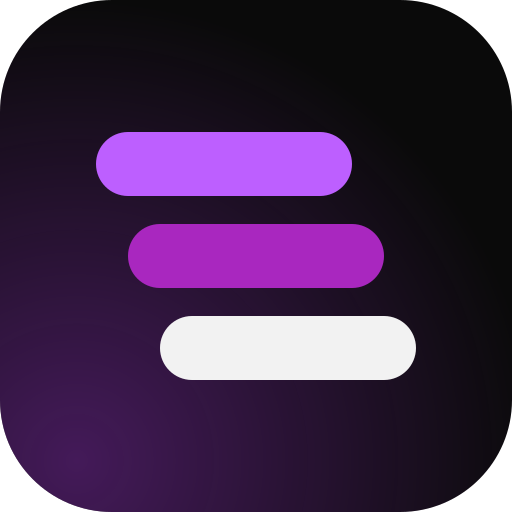

<p align="center">
  
</p>

<h1 align="center">Esdras Santos</h1>

<p align="center">
  The portfolio of a full stack developer who builds the whole thing, from the database to the app.<br>
  <a href="https://www.portfolioesdras.com">portfolioesdras.com</a>
</p>

This repo is the site itself: a Next.js 16 App Router project in English, Portuguese and Spanish, with a three.js hero, scroll-driven motion, a contact form that sends real email, and structured data so search engines and LLMs can read it. Every project page is generated from one data file, so adding a case study is three edits and no new routes.

## What's inside

- Three locales through `next-intl`. English lives at `/`, Portuguese at `/pt`, Spanish at `/es`.
- A three.js keyboard in the hero and a WebGL aurora background with a static CSS fallback. The keyboard stops rendering when it scrolls out of view, the aurora when the tab is hidden, and both hold still under `prefers-reduced-motion`.
- GSAP scroll reveals, Motion fades and Lenis smooth scrolling. The intro preloader plays once per browser session on the home page and never on deep links.
- A project catalog in `src/data/projects.ts` that feeds the home grid, `/projects`, every `/projects/[slug]` page, the sitemap and `/llms.txt`.
- A contact form backed by a Server Action: Zod validation, a honeypot field, 5 messages per IP every 10 minutes, and email through Nodemailer over SMTP.
- SEO that covers the boring parts: hreflang sitemap, `robots.txt`, JSON-LD (Person, WebSite, ProfilePage, BreadcrumbList), a generated OpenGraph image and `/llms.txt`.

## Brand

The mark is three stacked layers, one for each part of a product: the app on top in light purple, the API in the middle, the database at the base. Each layer sits one step to the right of the one above it. The source is `src/app/icon.svg`; Next.js turns it into the SVG favicon, and `favicon.ico`, `apple-icon.png` and the Android icons in `public/favicon/` are exported from it.

| Token      | Value     | Use                               |
| ---------- | --------- | --------------------------------- |
| Background | `#0a0a0a` | Page, icon tile                   |
| Ink        | `#e0e0e0` | Body text                         |
| Purple     | `#a927bf` | Primary buttons, accents          |
| Link       | `#bd5fff` | Links, highlighted words          |
| Type       | Satoshi   | Everything except code and labels |

## Tech stack

| Area        | Tools                                                      |
| ----------- | ---------------------------------------------------------- |
| Framework   | Next.js 16 (App Router), React 19, TypeScript              |
| Styling     | Tailwind CSS v4, Radix Select, Phosphor icons              |
| Motion & 3D | GSAP, Motion, Lenis, three.js                              |
| i18n        | next-intl                                                  |
| Backend     | Server Actions, Route Handlers, Nodemailer, Zod            |
| Tooling     | Bun, ESLint, Prettier, GitHub Actions (lint, types, build) |

## Run it locally

You need Bun (Node 20+ with npm works too).

```bash
git clone https://github.com/esdrassantos06/portfolio-esdras.git
cd portfolio-esdras
bun install
```

Create a `.env` file:

```bash
NEXT_PUBLIC_BASE_URL=http://localhost:3000
SMTP_HOST=smtp.gmail.com
SMTP_PORT=587
SMTP_USER=your@email.com
SMTP_PASS=your-app-password
CONTACT_TO=where-messages-land@email.com
```

`NEXT_PUBLIC_BASE_URL` is enough to browse the site. The SMTP variables only matter for the contact form; without them the form answers with a friendly error and points people to the email address instead.

```bash
bun dev
```

Then open [http://localhost:3000](http://localhost:3000).

## Scripts

| Command                | What it does                     |
| ---------------------- | -------------------------------- |
| `bun dev`              | Dev server                       |
| `bun run build`        | Production build                 |
| `bun start`            | Serve the production build       |
| `bun run lint`         | ESLint                           |
| `bun run typecheck`    | Route types plus `tsc --noEmit`  |
| `bun run format`       | Prettier, writing changes        |
| `bun run format:check` | Prettier, failing on differences |

CI runs lint, format check, typecheck and build on every pull request.

## Project structure

```
src/
├── app/
│   ├── [locale]/          # Home, projects, project detail, contact
│   ├── actions/           # Contact form Server Action
│   ├── api/health/        # Health check for the container
│   ├── llms.txt/          # Plain-text site summary for LLMs
│   ├── icon.svg           # Logo, also the favicon source
│   ├── opengraph-image.tsx
│   ├── robots.ts
│   └── sitemap.ts
├── components/            # Sections, layout, motion, UI primitives
├── data/projects.ts       # The project catalog
├── i18n/                  # Routing, request config, URL helpers
└── lib/                   # JSON-LD builders, contact schema
messages/                  # en.json, pt.json, es.json
public/                    # CV, fonts, 3D model, mockups, flags, icons
```

## Add a project

1. Add an entry to `src/data/projects.ts`: `slug`, `name`, `image`, `technologies`, `namespace`, and any of `demo`, `code`, `metrics`, `featuredHome`, `unreleased`. Projects marked `unreleased` only show up in development.
2. Add the `namespace` copy to all three files in `messages/`: `title` (the one-line pitch), `description` (paragraphs separated by a blank line), `Metadata`, and a `metrics` label for each metric.
3. Put the mockup in `public/projects-mockup/` (2560px wide is plenty) and import it at the top of `src/data/projects.ts`. The static import gives you the blur placeholder for free.

The home grid, `/projects`, the detail page with its "next project" link, the sitemap and `/llms.txt` all pick it up.

## License

MIT. See [LICENSE](LICENSE).

## Contact

- Email: esdrasirion1@gmail.com
- LinkedIn: [esdrassantos06](https://www.linkedin.com/in/esdrassantos06/)
- GitHub: [esdrassantos06](https://github.com/esdrassantos06)
